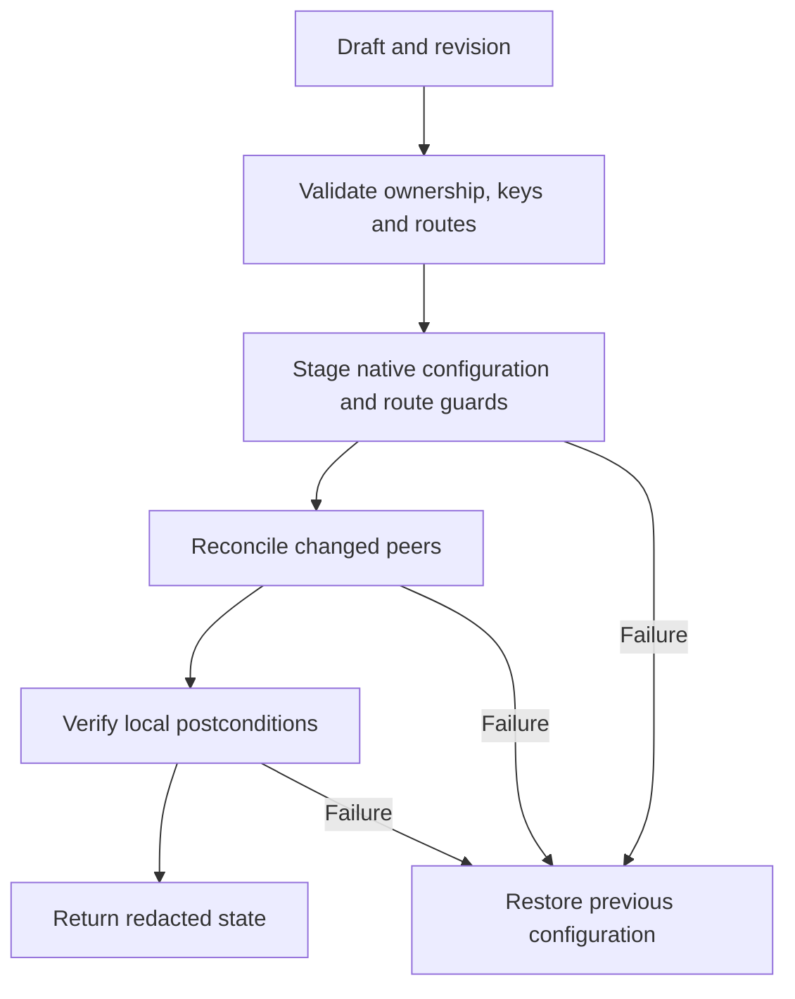

# Multi-peer IPsec management

RelayOS uses one native strongSwan/charon service for multiple independent
IKEv2/PSK peers. The editor changes configuration, not firmware or the kernel
baseline. SOE remains excluded. A configured peer is not proof of connectivity,
and a registered EIP-93 driver is not proof that a particular SA uses it.

## User-facing contract

- One global **Enable IPsec** switch, with one **Enable peer** switch per peer.
- Add and remove peers in the draft. Nothing changes on the device until
  **Save & Apply**. **Discard changes** reloads the current configuration.
- Basic parameters: name, endpoint IPv4/DNS hostname, local and remote IKE
  identities, PSK, local tunnel IPv4 `/32`, and remote IPv4 CIDRs.
- Advanced parameters: IKE and ESP proposal, DPD interval, and tunnel MTU.
  NAT detection/NAT-T is automatic; no experimental SOE toggle is provided.
- Stored PSKs are never returned by the management RPC. Leaving an existing
  key field blank keeps its value; entering a key replaces it. New peers need
  a key. Keys are cleared from the editor after a successful save.
- Connection labels distinguish a configured/enabled peer, an IKE negotiation,
  and an established IKE SA with an installed CHILD_SA. Refreshing status must
  not silently apply or discard an unsaved draft.

The manual editor is unavailable while AirRoute Agent owns the device, when
ownership cannot be determined, or for a read-only session. The backend repeats
the ownership check under its operation lock; hiding a button is not the
authorization boundary.

## Addressing and proposals

| Parameter | Contract |
| --- | --- |
| Address family | IPv4 inner and outer configuration in this editor |
| Local tunnel address | Unique unicast `/32` per peer |
| Remote prefixes | Explicit nondefault CIDRs; overlap between peers, local networks and WireGuard routes is rejected |
| IKE IDs | Exact identities; no wildcard/range identities, duplicate remote IDs or local/remote identity collisions |
| PSK | 16–128 UTF-8 bytes; use a randomly generated secret, preferably 256 bits or more |
| DPD interval | 10–3600 seconds; default 30 |
| MTU | 576–1500; default 1400; tune against the real outer path |
| IKE | `aes128-sha256-modp2048` (default) or `aes256-sha256-modp2048` |
| ESP | `aes128-sha256-noesn` (default), `aes256-sha256-noesn`, or `aes128gcm16-noesn` |

The editor currently accepts up to 64 peers, 32 remote prefixes per peer and
256 remote prefixes in total, including disabled peers. These bound the low-
resource manager's validation, route transactions and diagnostic buffers;
they are **not** protocol limits or a hardware capacity claim. Every peer has
its own stable, nonzero 31-bit local XFRM interface ID, matching the pinned
jshn/netifd integer type. XFRM IDs do not have to equal
the remote machine's local IDs. They must match the local interface and the
local CHILD_SA's inbound/outbound IDs.

Each secret is bound **only** to its peer's remote identity. strongSwan accepts
a secret as a candidate when either local or remote identity matches; also
binding a shared local identity would allow other peers' secrets into the
authentication candidate set. Multiple peers may share a local identity, but
no local identity may equal any peer's remote identity (compared case-
insensitively and without a leading `@`). Bare IPv4 ranges are rejected;
an explicit `@` denotes an exact FQDN identity. Use a different random PSK for
each peer; deliberately reusing identical key bytes is still sharing a secret.

The first-hop machine must independently be configured with matching PSK,
opposite local/remote identities, compatible IKE/ESP proposals and traffic
selectors. For this exit-node role, RelayOS's local selector permits IPv4
destinations while the remote selector is the peer's explicitly assigned
prefixes. This editor does not provision the remote server.

## Apply and isolation



The product's source of truth is `/etc/config/relay_ipsec`. The constrained
`relay.ipsec` RPC exposes only `get` and `apply`. The request includes a revision
so that an older browser tab cannot overwrite a newer configuration. Native
generated sections carry an ownership marker. Name collisions, unsupported
unmanaged IPsec configuration, and pending UCI changes cause an explicit error
instead of overwriting another configuration.

The generated datapath uses a native netifd `xfrm` interface plus a static
address alias for each peer; `proto xfrm` alone does not assign an IP address.
Only explicitly assigned remote prefixes are routed to the alias. Automatic
strongSwan route installation stays disabled. A separate IPsec firewall zone
does not permit peer-to-peer forwarding or access to SSH/LuCI. Exit forwarding
uses the existing uplink role. WireGuard interfaces, keys and peer sections
are not regenerated or restarted.

If all enabled endpoints are literal IPv4 addresses, inbound IKE (UDP 500/4500)
and ESP rules are restricted to those addresses. If any enabled endpoint is a
DNS hostname, fw4 cannot use that hostname as a source-IP filter: these two
rules accept sources from the uplink zone, while IKE identity/PSK authentication
still restricts tunnel establishment. This does **not** expose SSH/LuCI or allow
unauthenticated tunnel traffic. Use literal endpoint IPs when a fixed source
allowlist is required.

A full, validated swanctl configuration is loaded because `--load-conns`
reconciles the complete connection set. Passing just one peer's configuration
would unload other peers. Unchanged definitions are preserved by strongSwan;
affected IKE SAs are explicitly terminated for key changes, disable and removal.
Changing a display name alone does not require a new IKE SA. No global XFRM
state/policy flush is used. Turning the global switch off intentionally stops
all managed IPsec peers, but does not stop WireGuard.

Enabled peers initiate automatically, recover through DPD, and reconnect after
a remote graceful close. A native charon retry interval also covers a failed
initial endpoint DNS lookup; no second IKE daemon or polling service is added.

## Disable, remove and failure behavior

- **Disable a peer or the global service:** preserve that configured peer's
  protected routes. Traffic must not fall through to the normal uplink merely
  because its SA or XFRM interface is unavailable.
- **Delete a peer:** deliberately release its configured prefixes and remove
  only its owned configuration after terminating its SAs. Deletion is not a
  persistent prohibition on future plain routing to that destination.
- **Rejected configuration:** do not change persisted configuration or any
  running connection.
- **Runtime apply failure:** attempt restoration and report failure. A failed
  apply may already have terminated the changed peer's SA; restoring the old
  configuration cannot preserve that SA's previous identity or packet counters.
  Unchanged peers must not be globally restarted as a rollback shortcut.
- **Rollback failure:** report it distinctly and require inspection over SSH;
  do not display success or pretend all previous SAs were restored.

Each protected prefix has an independent native `unreachable` route with a
higher metric than its active XFRM route. New guards are installed before
affected active routing is withdrawn. These guards protect the ordinary apply
and interface-down paths; this is not a claim of atomicity during a full manual
network restart, loopback reconfiguration, power loss, or external route edits.

The editor never supplies arbitrary shell commands or filesystem paths.
Credentials use RPC stdin and root-only UCI files. The upstream swanctl renderer
receives hex-encoded literal PSK bytes, preventing quoting/config injection and
preserving a password which itself begins with `0x`. Error responses contain
allowlisted codes rather than raw command output or credentials.

## Verification and hardware acceptance

Repository regressions cover the frontend state machine, strict validation,
native configuration planning, ownership, revision/lock checks, per-peer
reconciliation and failure handling. Tests use synthetic keys and disposable
configuration directories; they do not flash a device or mutate a real tunnel.

The default `scripts/test-console.sh` run covers dependency-free console
regressions and the fixed shell/RPC bridge. Additional tests must be run
explicitly on a Linux development host with their dependencies available:

```sh
# Exact product-pinned host ucode with fs/uci modules and UCI CLI.
UCODE=/absolute/path/to/ucode UCI=/absolute/path/to/uci \
  bash scripts/test-ipsec-native.sh

# Real pinned LuCI DOM/RPC implementation in jsdom; not browser/layout QA.
JSDOM_MODULE=/absolute/path/to/node_modules/jsdom \
LUCI_DIR=/absolute/path/to/pinned/luci \
  node tests/test-ipsec-dom.cjs
```

Set `LD_LIBRARY_PATH` if the locally built native tools require private shared
libraries. The DOM test checks the LuCI revision against `feeds.conf` and rejects
modified upstream DOM/RPC source. The runtime test rewrites only its disposable
copy's fixed paths and device-command adapters; production code has no test-mode
environment switch. Neither additional test silently passes without dependencies.

The host tool revisions in the current OpenWrt lock are ucode
`dfc64d41fd720163ac21d9feb9cb224d1a80fd75` and UCI
`66127cd76c5d0bd46d5a90302cc6110f53a4e2f8`; the DOM regression was also exercised
with jsdom 31.0.1. A firmware build alone does not run these extra host tests.

Before a production rollout, test two IPsec peers and an active WireGuard
tunnel on each target board:

1. Enable both peers and verify an installed CHILD_SA and bidirectional traffic
   for each. Verify identities, selectors and remote routes on both machines.
2. Change A's PSK or endpoint, disable/re-enable A, then remove A. B's SA and
   WireGuard must remain usable and retain their existing sessions.
3. Disconnect A, remove its XFRM interface temporarily, and verify that its
   configured prefixes hit the unreachable guard, not the plaintext uplink.
4. Exercise invalid/overlapping routes, a stale browser revision, concurrent
   saves, service-start failure and an Agent ownership change.
5. Reboot and perform a configuration-preserving firmware upgrade. Confirm
   settings and keys survive, private files remain private, and all enabled
   peers recover without restoring disabled peers.
6. Measure EIP-93 throughput separately, as described in
   [hardware qualification](ipsec-soe.md). Management tests do not prove crypto
   offload, throughput, MTU suitability or interoperability with a real peer.

The pinned upstream behavior was checked in OpenWrt's `swanctl.init`, native
`xfrm.sh`, netifd route reconciliation, and strongSwan 6.0.7's `load_conns.c`,
`load_creds.c`, `vici_config.c`, `terminate.c`, `list_sas.c`, `mem_cred.c`,
`identification.c` and `psk_authenticator.c`. The implementation
must verify postconditions: some upstream command paths return zero even if
part of the configuration failed to load.
